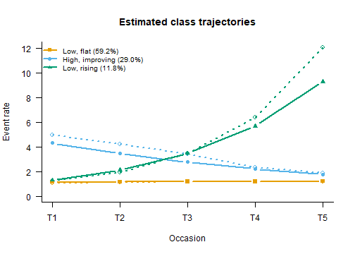

# Count Trajectories: Poisson, Zero-Inflated and Negative Binomial LCGA

``` r

library(mixtureEM)
```

Many outcomes followed over time are counts: days absent, drinks per
week, arrests per year, visits to a doctor. A latent class growth
analysis (LCGA) of a count looks for groups of cases that share a
trajectory in the *rate* of the event, on the log scale, the way Nagin’s
group-based trajectory model does (Nagin & Land, 1993; Nagin, 1999).
[`fit_lcga()`](https://pdvalencia.github.io/mixtureEM/reference/fit_lcga.md)
offers three distributions for the count within a class, and the choice
between them is the first decision of the analysis, made before the
number of classes. This vignette is about that decision. What an LCGA
is, and how it differs from a growth mixture model, is in
[`vignette("growth_mixture")`](https://pdvalencia.github.io/mixtureEM/articles/growth_mixture.md).

## The data: absences over five school terms

The example is simulated, so that the right answer is known. One
thousand students are followed over five terms; each term records how
many days the student was absent. Three groups are built in: most
students (60%) miss about one day a term throughout, a second group
(28%) starts high and improves, and a small third group (12%) starts low
and climbs steeply. Within each group the counts vary far more than a
Poisson count would, which is what real absence data do: some students
in the same group are hardly ever away and others miss a week at a time.
One answer in twenty is missing, as if a term’s register had been lost
at random.

``` r

set.seed(2070)
n <- 1000
term <- 0:4
class <- sample(1:3, n, replace = TRUE, prob = c(0.60, 0.28, 0.12))
intercept <- c(0.2, 1.5, 0.4)[class]   # log of the expected count at term 1
slope     <- c(0.0, -0.25, 0.40)[class] # change in the log count per term
mu <- exp(intercept + outer(slope, term))
absences <- matrix(rnbinom(n * 5, size = 1 / 0.7, mu = mu), n, 5,
                   dimnames = list(NULL, paste0("term", 1:5)))
absences[runif(n * 5) < 0.05] <- NA
head(absences)
#>      term1 term2 term3 term4 term5
#> [1,]     1     3     0     1     0
#> [2,]     1     0     0     1     2
#> [3,]     1     1     1     1     0
#> [4,]     1     0     3     0     1
#> [5,]     1     3     1     2     0
#> [6,]     4     2     5     0     0
```

The counts are drawn from a negative binomial with dispersion 0.7, so
within a group the variance is the mean plus 0.7 times the mean squared.
`class` is the truth the analysis will try to recover; a real analysis
never has it.

## Look at the counts before choosing a model

``` r

round(rbind(mean     = colMeans(absences, na.rm = TRUE),
            variance = apply(absences, 2, var, na.rm = TRUE),
            zeros    = colMeans(absences == 0, na.rm = TRUE)), 2)
#>          term1 term2 term3 term4 term5
#> mean      2.05  1.97  1.90  1.94  2.39
#> variance  8.89  6.25  5.29  7.13 17.89
#> zeros     0.33  0.32  0.32  0.32  0.35
```

Two features stand out. The variance is between three and eight times
the mean at every term, and about a third of all answers are zero.
Neither is conclusive on its own, because a mixture of groups with
different rates also has a variance above its mean. But a variance this
far above the mean, with a third of the counts at zero while the mean is
two, is what counts that vary within groups look like.

## Choose the distribution first

The three families of
[`fit_lcga()`](https://pdvalencia.github.io/mixtureEM/reference/fit_lcga.md)
make three different claims about a student *within* a trajectory group:

- `family = "poisson"`: the count’s variance equals its mean. Students
  in a group differ only by chance.
- `family = "negbin"`: the variance is the mean plus `alpha` times the
  mean squared (the NB2 form; Cameron & Trivedi, 2013, ch. 3). Students
  in a group differ in their own rates, by an amount `alpha` measures.
  With `alpha = 0` it is the Poisson.
- `family = "zip"`: some zeros are *structural*. A share of the group is
  not at risk at all (a student who is never absent, an adolescent who
  does not drink), and the rest follow a Poisson count (Lambert, 1992).

Which of these describes a group of students is a question about the
outcome, answered on substantive grounds and from plots like the table
above. It is not answered by comparing the families’ BIC. A model that
cannot represent the spread within groups can only represent it with
more groups, so its BIC keeps improving as classes are added, and lining
up the families’ BICs rewards the family that has spent the most classes
on the spread. In a simulation of growth mixtures, the lowest BIC across
families belonged to a one-class model of a symmetric family fitted to
skewed data (Guerra-Peña et al., 2020).
[`compare_longitudinal()`](https://pdvalencia.github.io/mixtureEM/reference/compare_longitudinal.md)
therefore ranks the number of classes *within* one family, and prints a
fit from another family in a block of its own, unranked.

For these data the case for the negative binomial is the variance:
absence is not a coin that lands the same way for everyone in a group.
The zeros are a separate question, taken up at the end.

Every fit below switches off the package’s default priors, which keep
estimates away from the boundary and are the right default for
exploratory work. Without them the fits are plain maximum likelihood,
the estimator the count models above are defined by;
[`vignette("estimation")`](https://pdvalencia.github.io/mixtureEM/articles/estimation.md)
explains what the priors add and when to keep them.

``` r

ml <- list(latent = 0, categorical = 0, poisson = 0, variances = 0)
```

## How many classes: negative binomial

``` r

nb <- compare_longitudinal(absences, model = "lcga", times = 5,
                           k_range = 1:4, family = "negbin",
                           n_init = 50, random_state = 1,
                           bayes_constants = ml, verbose = FALSE)
nb
#> 
#> === Model Selection Summary ===
#>  Classes         LL Params       BIC     SABIC      AIC3 Entropy
#>        1 -9138.300       7 18324.954 18302.722 18297.600        
#>        2 -9022.445      10 18113.968 18082.208 18074.891   0.662
#>        3 -8964.127      13 18018.055 17976.766 17967.254   0.573
#>        4 -8961.453      16 18033.431 17982.614 17970.906   0.625
#> 
#> -> Best model according to BIC: 3 classes
#>    print(x, columns = "all") adds AIC, CAIC, AWE, ICL, BF and cmP.
```

BIC falls from one class to three and rises at four, and the four-class
log-likelihood is only 2.7 units above the three-class one for three
more parameters. Three classes it is, which is what was simulated. The
relative entropy of 0.57 says the classes overlap: with this much spread
within a group, a student’s five counts do not always say which group
they come from. That is a property of the data, not a defect of the fit,
and it is the reason the bias-adjusted three-step methods exist when the
classes are later related to other variables
([`vignette("estimation")`](https://pdvalencia.github.io/mixtureEM/articles/estimation.md)).

## What the Poisson model does with the same counts

``` r

po <- compare_longitudinal(absences, model = "lcga", times = 5,
                           k_range = 1:4, family = "poisson",
                           n_init = 50, random_state = 1,
                           bayes_constants = ml, verbose = FALSE,
                           alongside = list(`negbin, 3 classes` = nb$models$K3))
po
#> 
#> === Model Selection Summary ===
#>  Classes          LL Params       BIC     SABIC      AIC3 Entropy
#>        1 -11767.298       2 23548.412 23542.059 23540.596        
#>        2 -10493.405       5 21021.349 21005.469 21001.810   0.938
#>        3  -9817.461       8 19690.183 19664.775 19658.921   0.874
#>        4  -9722.423      11 19520.832 19485.895 19477.846   0.844
#> 
#> -> Best model according to BIC: 4 classes
#>    print(x, columns = "all") adds AIC, CAIC, AWE, ICL, BF and cmP.
#> 
#> === Shown alongside, not ranked ===
#>              Model            Family Classes        LL Params       BIC
#>  negbin, 3 classes negative binomial       3 -8964.127     13 18018.055
#>      SABIC      AIC3 Entropy
#>  17976.766 17967.254   0.573
#> Not ranked against the table above: that fit assumes a different
#> within-class distribution (negative binomial, against Poisson), and
#> choosing among distributions is a modelling decision made on
#> substantive and distributional grounds -- is the scale bounded, are the
#> counts zero-heavy, are there outliers -- not a fit-index one.
```

Fitted as Poisson counts, the same data ask for at least four classes,
and BIC is still falling steeply when the table stops: from three to
four classes it improves by 169 points. The extra classes are not groups
of students. They are the Poisson model’s only way to represent students
in one group who differ from each other. This is the pattern Berlin,
Parra and Williams (2014) warn about for LCGA in general: a BIC that
keeps improving as classes are added is a symptom of a within-class
assumption that does not hold, not evidence for many classes.

The negative binomial fit sits underneath in its own block, with no
ranking against the Poisson rows, for the reason given above.

## The three-class model

``` r

fit3 <- nb$models$K3
fit3
#> 
#> =========================================================
#>            LATENT CLASS GROWTH ANALYSIS
#> =========================================================
#> Occasions          : 5 (time scores 0, 1, 2, 3, 4)
#> Trajectory         : linear, log link
#> Wave attrition     : 243 case-occasions unobserved
#> 
#> GROWTH COEFFICIENTS (link scale)
#>         intercept linear
#> Class 1     0.137  0.010
#> Class 2     1.457 -0.222
#> Class 3     0.262  0.491
#> 
#> FITTED TRAJECTORY (event rate)
#>            T1    T2    T3    T4    T5
#> Class 1 1.147 1.158 1.170 1.182 1.195
#> Class 2 4.293 3.438 2.753 2.204 1.765
#> Class 3 1.300 2.123 3.469 5.667 9.259
#> 
#> OVERDISPERSION (alpha, variance = mean + alpha mean^2; per occasion, shared by the classes)
#>          T1    T2    T3    T4    T5
#> Alpha 0.635 0.629 0.641 0.557 0.742
#> =========================================================
#>                   LATENT MIXTURE MODEL                   
#> =========================================================
#> Classes Estimated  : 3
#> Estimation Method  : 1-step
#> Converged          : TRUE (in 37 iterations)
#> Missing Data       : 243 / 5000 cells (4.9%) in 5 items — FIML (MAR assumption)
#> ---------------------------------------------------------
#>   Log-Likelihood : -8964.13
#>   Parameters     : 13
#>   AIC            : 17954.25
#>   BIC            : 18018.05
#>   SABIC          : 17976.77
#>   Rel. Entropy   : 0.5728
#>   Best solution  : found by 50 of 50 starts
#> ---------------------------------------------------------
#> Class Weights (Sizes):
#>   Class 1: 59.22%
#>   Class 2: 29.03%
#>   Class 3: 11.75%
#> =========================================================
#> Type summary(model) for structural parameters or measurement_summary(model) for item parameters.
```

The three trajectories recover the simulated ones. Class 1 (59%) is the
flat group at a little over one day a term, against a simulated
`exp(0.2) = 1.22`. Class 2 (29%) starts at 4.3 days and falls by a fifth
a term (simulated: 4.5, falling by 22%). Class 3 (12%) starts at 1.3 and
rises by about 63% a term, to more than nine days by term five
(simulated: 1.5, rising 49%). The dispersion is near the simulated 0.7
at every term, which also answers the question that chose the family: a
Poisson count would have `alpha = 0`, and these estimates are more than
seven standard errors away from it (below).

``` r

plot(fit3, class_labels = c("Low, flat", "High, improving", "Low, rising"))
```



plot of chunk plot

The dotted lines are the observed means of the students assigned to each
class. The flat class sits on its curve. The other two run above theirs
where the classes are most distinct, the improving class at the start
and the rising class at the end: with entropy at 0.57, a student is
assigned to one of the smaller classes mostly when their counts are
extreme, so the assigned students are more extreme than the class they
stand for. The curves are the model’s estimate for the whole class, and
they are the ones to report.

[`growth_estimates()`](https://pdvalencia.github.io/mixtureEM/reference/growth_estimates.md)
gives every parameter with a standard error. Its default,
`se = "robust"`, is the sandwich estimator, which stays valid when the
within-class distribution is not exactly right; `se = "hessian"` gives
the classical one.

``` r

est <- growth_estimates(fit3)
est <- est[est$parameter != "fitted" &
             !(est$parameter == "overdispersion" & est$class > 1), ]
data.frame(est[, c("parameter", "item", "class")],
           estimate = round(est$estimate, 3), se = round(est$se, 3))
#>         parameter       item class estimate    se
#> 1     growth_mean  intercept     1    0.137 0.082
#> 2     growth_mean  intercept     2    1.457 0.080
#> 3     growth_mean  intercept     3    0.262 0.146
#> 4     growth_mean     linear     1    0.010 0.027
#> 5     growth_mean     linear     2   -0.222 0.030
#> 6     growth_mean     linear     3    0.491 0.052
#> 7  overdispersion         T1     1    0.635 0.087
#> 10 overdispersion         T2     1    0.629 0.072
#> 13 overdispersion         T3     1    0.641 0.069
#> 16 overdispersion         T4     1    0.557 0.069
#> 19 overdispersion         T5     1    0.742 0.089
#> 37    class_logit log(p1/p3)     1    1.617 0.168
#> 38    class_logit log(p2/p3)     2    0.904 0.220
```

The coefficients are on the log scale: Class 3’s `linear` of 0.491 means
its expected count is multiplied by `exp(0.491) = 1.63` each term. The
overdispersion rows are one `alpha` per term, shared by the classes (the
default, `dispersion = "occasion"`); `dispersion = "class"` estimates
one per class instead, constant over terms.

## Zero inflation

A zero-inflated model answers a different question: are some of the
zeros from students who were *never at risk*? That is a substantive
claim about the outcome, and where it holds it is a strong reason to
choose the ZIP. A count of cigarettes smoked has a group of non-smokers
whose zeros are structural; a count of school absences in a population
where every student can fall ill usually does not.

``` r

fit_zip <- fit_lcga(absences, times = 5, n_classes = 3, family = "zip",
                    n_init = 50, random_state = 1, bayes_constants = ml)
fit_zip
#> 
#> =========================================================
#>            LATENT CLASS GROWTH ANALYSIS
#> =========================================================
#> Occasions          : 5 (time scores 0, 1, 2, 3, 4)
#> Trajectory         : linear, log link
#> Wave attrition     : 243 case-occasions unobserved
#> 
#> GROWTH COEFFICIENTS (link scale)
#>         intercept linear
#> Class 1     0.484  0.014
#> Class 2     1.849 -0.245
#> Class 3     0.409  0.536
#> 
#> FITTED TRAJECTORY (event rate)
#>            T1    T2    T3    T4     T5
#> Class 1 1.622 1.645 1.668 1.692  1.716
#> Class 2 6.355 4.973 3.891 3.045  2.382
#> Class 3 1.506 2.574 4.399 7.518 12.848
#> 
#> ZERO INFLATION (probability of a structural zero, constant over occasions)
#>             Class 1 Class 2 Class 3
#> Probability    0.24   0.174   0.167
#> =========================================================
#>                   LATENT MIXTURE MODEL                   
#> =========================================================
#> Classes Estimated  : 3
#> Estimation Method  : 1-step
#> Converged          : TRUE (in 50 iterations)
#> Missing Data       : 243 / 5000 cells (4.9%) in 5 items — FIML (MAR assumption)
#> ---------------------------------------------------------
#>   Log-Likelihood : -9418.84
#>   Parameters     : 11
#>   AIC            : 18859.68
#>   BIC            : 18913.67
#>   SABIC          : 18878.73
#>   Rel. Entropy   : 0.8192
#>   Best solution  : found by 50 of 50 starts
#> ---------------------------------------------------------
#> Class Weights (Sizes):
#>   Class 1: 69.99%
#>   Class 2: 20.26%
#>   Class 3: 9.74%
#> =========================================================
#> Type summary(model) for structural parameters or measurement_summary(model) for item parameters.
```

The ZIP model finds the same three shapes, but it reads part of the
within-group spread as structural zeros: it estimates that 17% to 24% of
each group is never absent, and raises the at-risk rates to compensate.
Nobody in these data is immune to absence; that is how they were
simulated. A ZIP fit to overdispersed counts will find structural zeros
whether or not they exist, which is why the choice between the two
families is made on what the outcome is, and not on which one fits
better. Where the share of cases not at risk changes over time (a group
that stops smoking, say), `inflation_degree = 1` lets its logit rise or
fall linearly over the occasions.

## Summary

- Choose the count family before the number of classes, from what the
  outcome is and how it spreads within groups. Never pick it by
  comparing BIC across families.
- A Poisson LCGA fitted to overdispersed counts keeps adding classes;
  the extra classes are spread, not groups.
- `family = "negbin"` estimates the within-class spread directly;
  `family = "zip"` claims a share of cases is not at risk, and should be
  chosen when that claim is true of the outcome.
- [`compare_longitudinal()`](https://pdvalencia.github.io/mixtureEM/reference/compare_longitudinal.md)
  enumerates within one family and shows a fit of another family beside
  the table, unranked.

## References

Berlin, K. S., Parra, G. R., & Williams, N. A. (2014). An introduction
to latent variable mixture modeling (part 2): Longitudinal latent class
growth analysis and growth mixture models. *Journal of Pediatric
Psychology*, 39(2), 188-203.

Cameron, A. C., & Trivedi, P. K. (2013). *Regression analysis of count
data* (2nd ed.). Cambridge University Press.

Guerra-Peña, K., García-Batista, Z. E., Depaoli, S., & Garrido, L. E.
(2020). Class enumeration false positive in skew-t family of continuous
growth mixture models. *PLOS ONE*, 15(4), e0231525.

Lambert, D. (1992). Zero-inflated Poisson regression, with an
application to defects in manufacturing. *Technometrics*, 34(1), 1-14.

Nagin, D. S. (1999). Analyzing developmental trajectories: A
semiparametric, group-based approach. *Psychological Methods*, 4(2),
139-157.

Nagin, D. S., & Land, K. C. (1993). Age, criminal careers, and
population heterogeneity: Specification and estimation of a
nonparametric, mixed Poisson model. *Criminology*, 31(3), 327-362.
