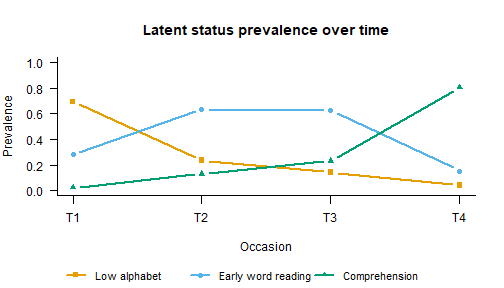

``` r
library(mixtureEM)
```

Latent transition analysis (LTA) is the longitudinal extension of LCA in
which cases can *move*: at each occasion every case occupies a latent
status, and the model estimates both what the statuses look like
(measurement) and the probabilities of moving between them from one
occasion to the next (transitions) (Collins & Lanza, 2010, ch. 7–8).

## The data: learning to read, kindergarten to first grade

`ecls_reading` holds 3,575 children from the Early Childhood Longitudinal
Study, Kindergarten Class of 1998–99 (ECLS-K), assessed four times — the
fall and spring of kindergarten and the fall and spring of first grade — on
whether they had mastered five reading skills: letter recognition,
beginning sounds, ending sounds, sight words and words in context. The
skills are acquired roughly in that order, which is what makes these data
a textbook case for a *stage-sequential* LTA (Kaplan, 2008): the latent
statuses are stages of learning to read, and children are expected to move
forward through them.


``` r
data(ecls_reading)
items <- ecls_reading[, -1]          # the 20 indicators; column 1 is poverty
round(colMeans(items), 2)
#>   letters_t1 beginning_t1    ending_t1     sight_t1   context_t1   letters_t2 
#>         0.64         0.32         0.18         0.03         0.01         0.90 
#> beginning_t2    ending_t2     sight_t2   context_t2   letters_t3 beginning_t3 
#>         0.73         0.53         0.15         0.05         0.93         0.82 
#>    ending_t3     sight_t3   context_t3   letters_t4 beginning_t4    ending_t4 
#>         0.68         0.27         0.10         0.97         0.93         0.90 
#>     sight_t4   context_t4 
#>         0.81         0.45
```

Mastery of every skill rises from occasion to occasion, and at any one
occasion the skills are ordered: almost everyone knows their letters by
the spring of kindergarten, while reading words in context is still rare a
year later. The indicator columns are already in the wide, occasion-major
layout `fit_lta()` expects — the five items at `t1`, then the five at
`t2`, and so on.

## Fitting the LTA

`fit_lta()` needs the number of statuses and how the columns divide into
occasions. Three statuses is the choice the published analyses of these
data settle on, and `compare_longitudinal()` can be used to check it. By
default the item-response probabilities are held equal across occasions
(`measurement_invariance = "full"`), which is what makes "the same status
at different times" a meaningful phrase:


``` r
fit <- fit_lta(items, n_statuses = 3, times = 4, measurement = "binary",
               n_init = 50, random_state = 7)
fit
#> 
#> =========================================================
#>              LATENT TRANSITION ANALYSIS
#> =========================================================
#> Latent statuses    : 3
#> Items x Occasions  : 5 x 4
#> Item parameters    : binary, held equal across occasions
#> Transitions        : 3 tables, one per pair of occasions
#> Converged          : TRUE (in 31 iterations)
#> ---------------------------------------------------------
#>   Log-Likelihood : -21794.40
#>   Parameters     : 35
#>   AIC            : 43658.80
#>   BIC            : 43875.16
#>   SABIC          : 43763.95
#>   Rel. Entropy   : 0.9038
#>   Best solution  : found by 50 of 50 starts
#> ---------------------------------------------------------
#> Latent status prevalences by occasion:
#>    Status 1 Status 2 Status 3
#> T1   0.6940   0.2832   0.0228
#> T2   0.2350   0.6349   0.1301
#> T3   0.1419   0.6261   0.2320
#> T4   0.0407   0.1540   0.8053
#> =========================================================
#> Type summary(model) for transitions, measurement_summary(model) for items.
```

Latent transition models have many local maxima, and the `Best solution`
line — every one of the 50 starts reached this one — is the evidence that
this is not one of them. When that count is low, raise `n_init`; see
`vignette("estimation")`.

### What the statuses are

Status numbers are arbitrary labels. Read the item-response probabilities
before naming them:


``` r
measurement_summary(fit)
#> 
#> =========================================================
#>         MEASUREMENT MODEL PARAMETERS (by occasion)
#> =========================================================
#> Held equal across occasions; one set shown.
#> =========================================================
#>              MEASUREMENT MODEL PARAMETERS                
#> =========================================================
#> 
#> CATEGORICAL PROBABILITIES
#> Indicator            | Overall | Class 1 | Class 2 | Class 3
#> ------------------------------------------------------------ 
#> letters@T1           |   0.860 |   0.505 |   0.994 |   1.000
#> beginning@T1         |   0.700 |   0.066 |   0.917 |   0.984
#> ending@T1            |   0.573 |   0.013 |   0.661 |   0.972
#> sight@T1             |   0.315 |   0.000 |   0.051 |   0.984
#> context@T1           |   0.152 |   0.000 |   0.001 |   0.509
#> 
#> At the boundary: letters@T1 in class 3; sight@T1 in class 1; context@T1 in class 1. These probabilities have run to 0 or 1, so the class is defined partly by an item every case in it gives the same answer to, and their standard errors are not interpretable. There are two ways on: read it substantively, since an item every member of a class answers identically is often the finding rather than a fault; or, if that parameter needs a standard error, refit with a stronger prior than the default of 1 - `bayes_constants = list(categorical = 2)` - which holds the estimate off the edge at the cost of shrinking it slightly toward the item's marginal.
#> =========================================================
```

The three statuses are three stages of learning to read:

* **Low alphabet knowledge** — about half know their letters and almost
  nothing beyond;
* **Early word reading** — letters and beginning sounds mastered, ending
  sounds coming, sight words not yet;
* **Early reading comprehension** — everything mastered except, for about
  half of them, words in context.

The `At the boundary` note is worth reading rather than fearing. Nobody in
the low-alphabet stage reads sight words or words in context, and everyone
in the comprehension stage knows their letters: those probabilities are 0
and 1 because that is what the stages *are*, not because the estimation
went wrong. The note only matters if a standard error for one of those
cells is needed, and says what to do then.

`fit_lta()` labels the statuses from most to least prevalent at the first
occasion, which here coincides with the developmental order, so status 1 is
the earliest stage and status 3 the latest.

### Prevalences and transitions

The two core quantities of an LTA are the status prevalences at each
occasion and the transition matrices:


``` r
status_prevalences(fit)
#>      Status 1  Status 2   Status 3
#> T1 0.69397743 0.2832291 0.02279346
#> T2 0.23497126 0.6348937 0.13013503
#> T3 0.14192716 0.6260530 0.23201987
#> T4 0.04074088 0.1539600 0.80529915
transition_matrix(fit)
#> $`T1 -> T2`
#>           to
#> from           Status 1    Status 2  Status 3
#>   Status 1 0.3382361420 0.649245556 0.0125183
#>   Status 2 0.0007471057 0.650705904 0.3485470
#>   Status 3 0.0013780845 0.001451571 0.9971703
#> 
#> $`T2 -> T3`
#>           to
#> from          Status 1    Status 2    Status 3
#>   Status 1 0.596435684 0.401041254 0.002523062
#>   Status 2 0.002270869 0.836826166 0.160902965
#>   Status 3 0.002613873 0.004027645 0.993358482
#> 
#> $`T3 -> T4`
#>           to
#> from          Status 1     Status 2  Status 3
#>   Status 1 0.262684467 0.5045190889 0.2327964
#>   Status 2 0.005134317 0.1314941111 0.8633716
#>   Status 3 0.001053633 0.0001410571 0.9988053
```

Rows are where children start, columns where they end up, so the diagonal
holds the probability of staying put. Seven in ten enter kindergarten in
the low-alphabet stage; by the spring of first grade eight in ten are in
the comprehension stage. Movement is almost entirely forward — the cells
below the diagonal are all near zero — and the interval with the least
movement is the middle one, the summer between kindergarten and first grade, where
60% of the low-alphabet children and 84% of the early-word readers stay
where they were. `plot()` shows both views:


``` r
labs <- c("Low alphabet", "Early word reading", "Comprehension")
plot(fit, type = "prevalence", status_labels = labs)
```



## Is the transition process the same at every interval?

`transition_invariance = "full"` forces one transition matrix for all
intervals; comparing it against the unrestricted model is a
likelihood-ratio test of a time-homogeneous process:


``` r
fit_hom <- fit_lta(items, n_statuses = 3, times = 4, measurement = "binary",
                   transition_invariance = "full", n_init = 50,
                   random_state = 7)
lr_test(fit_hom, fit)
#> 
#> Likelihood-ratio test for nested models
#> ---------------------------------------------------------
#>   Restricted : LL =  -22935.6514   parameters = 23
#>   Full       : LL =  -21794.4016   parameters = 35
#>   -2 x diff  : 2282.4996   df = 12   p = < 1e-16
#>   The restriction is rejected: the full model fits significantly better.
```

It is rejected decisively. That is the summer: a school year moves children
forward at a rate a vacation does not, and one shared matrix cannot express
it.

## A stage-sequential restriction

If the stages are truly ordered, backward moves are impossible by design
and can be fixed at zero with `forbidden_transitions`, which also saves
their parameters:


``` r
forward_only <- matrix(c(0, 0, 0,     # from Low alphabet: anything allowed
                         1, 0, 0,     # from Early word:   no return to Low
                         1, 1, 0),    # from Comprehension: no return at all
                       3, 3, byrow = TRUE)
fit_fwd <- fit_lta(items, n_statuses = 3, times = 4, measurement = "binary",
                   forbidden_transitions = forward_only, n_init = 50,
                   random_state = 7)
c(unrestricted = fit$metrics$bic, forward_only = fit_fwd$metrics$bic)
#> unrestricted forward_only 
#>     43875.16     43879.93
```

The two BICs are almost tied, and the unrestricted fit is 40 log-likelihood
units better for its nine extra parameters. The backward transitions it
estimates are tiny, but with a sample this size a handful of children who
look as though they slipped back is enough for the model to want them.
Whether those slips are real regression or measurement noise — a child who
knew ending sounds in the spring and missed the item in the fall — is a
question regular LTA cannot answer, because it has no way to represent a
stable difference between children that is not a stage. That is what a
random intercept adds; see `vignette("rilta")`.

## A mover-stayer model

A *mover-stayer* model (Vermunt, 2004) adds a latent class **above** the
chain: one group transitions freely (the movers) while the other is locked
in place (the stayers). It asks whether there is a genuinely immobile
group — here, children who do not progress at all across the two years:


``` r
fit_ms <- fit_lta(items, n_statuses = 3, times = 4, measurement = "binary",
                  mover_stayer = TRUE, n_init = 20, random_state = 7,
                  max_iter = 2000)
c(single_chain = fit$metrics$bic, mover_stayer = fit_ms$metrics$bic)
#> single_chain mover_stayer 
#>     43875.16     43894.49
```

The stayer class is small (about 6%) and buys too little likelihood for its
three parameters: BIC prefers the single chain. On these data nearly
everyone moves.

## Poverty as a covariate

Covariates can predict the status children start in
(`predictors_initial`) and the transitions they make
(`predictors_transition`). One slope per covariate is shared across origin
statuses within each interval (`transition_effects = "common"`), which is
the well-behaved specification; the alternative, a separate regression per
origin, is saturated and fails to converge usefully when transitions are
sparse.


``` r
fit_pov <- fit_lta(items, n_statuses = 3, times = 4, measurement = "binary",
                   predictors_initial = ecls_reading["poverty"],
                   predictors_transition = ecls_reading["poverty"],
                   n_init = 20, random_state = 7)
c(no_covariate = fit$metrics$bic, poverty = fit_pov$metrics$bic)
#> no_covariate      poverty 
#>     43875.16     43521.91
```

Poverty improves BIC by some 350 points. One thing to check before reading
the coefficients: once covariates index the statuses, `fit_lta()` no longer
relabels them by prevalence, so the numbering may differ from the fit
above. `status_prevalences()` says which is which —


``` r
round(status_prevalences(fit_pov), 3)
#>    Status 1 Status 2 Status 3
#> T1    0.023    0.285    0.692
#> T2    0.130    0.636    0.234
#> T3    0.232    0.628    0.140
#> T4    0.805    0.154    0.041
```

— here status 3 is the low-alphabet stage (the one 69% start in), status 2
early word reading and status 1 comprehension. The coefficients are
multinomial logits against the last status, so with this labelling every
contrast is *relative to the low-alphabet stage*:


``` r
lta_covariate_summary(fit_pov)
#> 
#> =========================================================
#>    LATENT TRANSITION MODEL - COVARIATE EFFECTS (logits)
#> =========================================================
#> Reference status: 3. Coefficients are contrasts against it;
#> exp(coefficient) is an odds ratio.
#> 
#> PREDICTING LATENT STATUS AT THE FIRST OCCASION
#>    Status      Term Estimate    SE      z        p    OR
#>  Status 1 Intercept   -3.165 0.126 -25.13  < 1e-16 0.042
#>  Status 1   poverty   -2.040 0.576  -3.54 0.000402 0.130
#>  Status 2 Intercept   -0.676 0.048 -14.13  < 1e-16 0.509
#>  Status 2   poverty   -1.459 0.149  -9.82  < 1e-16 0.233
#> 
#> PREDICTING TRANSITIONS
#> 
#>   [occasion 1 -> 2]
#>       Status      Term Estimate    SE      z        p        OR
#>  to Status 1 Intercept   -3.054 0.275 -11.11  < 1e-16     0.047
#>  to Status 1    from:1    9.690 3.014   3.21  0.00131 16153.881
#>  to Status 1    from:2    9.077 1.336   6.79 1.11e-11  8750.985
#>  to Status 1   poverty   -0.783 0.269  -2.91  0.00365     0.457
#>  to Status 2 Intercept    0.980 0.059  16.52  < 1e-16     2.664
#>  to Status 2    from:1   -0.880 4.243  -0.21  0.83572     0.415
#>  to Status 2    from:2    5.707 1.310   4.36 1.31e-05   300.973
#>  to Status 2   poverty   -1.187 0.106 -11.18  < 1e-16     0.305
#> 
#>   [occasion 2 -> 3]
#>       Status      Term Estimate    SE     z        p        OR
#>  to Status 1 Intercept   -5.016 0.979 -5.12 3.03e-07     0.007
#>  to Status 1    from:1   11.484 1.380  8.32  < 1e-16 97108.895
#>  to Status 1    from:2    9.401 1.220  7.71 1.27e-14 12097.072
#>  to Status 1   poverty   -2.133 0.376 -5.68 1.37e-08     0.119
#>  to Status 2 Intercept   -0.030 0.108 -0.28    0.779     0.970
#>  to Status 2    from:1    0.678 1.558  0.44    0.663     1.970
#>  to Status 2    from:2    5.952 0.731  8.15 3.75e-16   384.645
#>  to Status 2   poverty   -0.917 0.180 -5.09 3.53e-07     0.400
#> 
#>   [occasion 3 -> 4]
#>       Status      Term Estimate    SE     z        p       OR
#>  to Status 1 Intercept    0.279 0.178  1.57 0.116143    1.322
#>  to Status 1    from:1    7.042 2.078  3.39 0.000701 1143.424
#>  to Status 1    from:2    5.022 0.362 13.88  < 1e-16  151.667
#>  to Status 1   poverty   -0.932 0.228 -4.08 4.43e-05    0.394
#>  to Status 2 Intercept    0.695 0.168  4.14 3.44e-05    2.004
#>  to Status 2    from:1   -2.335 3.648 -0.64 0.522175    0.097
#>  to Status 2    from:2    2.565 0.363  7.06 1.64e-12   13.001
#>  to Status 2   poverty   -0.109 0.213 -0.51 0.608549    0.897
#> 
#> =========================================================
```

Read against the low-alphabet stage, poverty lowers the odds of starting
kindergarten beyond it
(OR 0.23 for early word reading, 0.13 for comprehension), and lowers the
odds of reaching comprehension in every interval. The effect is sharpest
over the summer, where a child in poverty has 0.40 times the odds of
reaching early word reading and 0.12 times the odds of reaching
comprehension, relative to staying in low alphabet. The `from:` terms are
the origin-status intercepts and are not of interest in themselves; the
ones with large standard errors belong to cells almost nobody occupies.

### The same question in three steps

In the fit above the covariate and the statuses are estimated together, so
poverty has a say in what the statuses *are*: a status is partly defined by
who is poor. Usually that pull is small, but nothing guarantees it, and it
means adding or dropping a covariate can quietly change the statuses whose
prevalences you are comparing. The stepwise estimators remove it. With
`n_steps = 3` (Vermunt, 2010; Nylund-Gibson et al., 2014) `fit_lta()` first
fits the LTA with no covariates, then assigns every child a status at every
occasion, and finally regresses those assigned statuses on poverty while
correcting for the children the assignment gets wrong. The statuses are fixed
before poverty is ever looked at.


``` r
fit_pov3 <- fit_lta(items, n_statuses = 3, times = 4, measurement = "binary",
                    predictors_initial = ecls_reading["poverty"],
                    predictors_transition = ecls_reading["poverty"],
                    n_steps = 3, n_init = 20, random_state = 7)
round(status_prevalences(fit_pov3), 3)
#>    Status 1 Status 2 Status 3
#> T1    0.683    0.296    0.021
#> T2    0.231    0.629    0.141
#> T3    0.134    0.631    0.235
#> T4    0.039    0.153    0.807
```

Here status 1 is the low-alphabet stage, status 2 early word reading and
status 3 comprehension, so the contrasts below are all against comprehension:


``` r
lta_covariate_summary(fit_pov3)
#> 
#> =========================================================
#>    LATENT TRANSITION MODEL - COVARIATE EFFECTS (logits)
#> =========================================================
#> Reference status: 3. Coefficients are contrasts against it;
#> exp(coefficient) is an odds ratio.
#> 
#> PREDICTING LATENT STATUS AT THE FIRST OCCASION
#>    Status      Term Estimate    SE     z       p     OR
#>  Status 1 Intercept    3.252 0.152 21.44 < 1e-16 25.831
#>  Status 1   poverty    1.865 0.675  2.76 0.00573  6.453
#>  Status 2 Intercept    2.622 0.158 16.61 < 1e-16 13.768
#>  Status 2   poverty    0.462 0.699  0.66 0.50926  1.586
#> 
#> PREDICTING TRANSITIONS
#> 
#>   [occasion 1 -> 2]
#>       Status      Term Estimate    SE     z        p        OR
#>  to Status 1 Intercept   -6.444 2.997 -2.15 0.031525     0.002
#>  to Status 1    from:1   10.536 3.113  3.38 0.000713 37633.995
#>  to Status 1    from:2   -1.311 4.240 -0.31 0.757193     0.270
#>  to Status 1   poverty    0.766 0.347  2.21 0.027233     2.152
#>  to Status 2 Intercept   -6.082 3.002 -2.03 0.042785     0.002
#>  to Status 2    from:1   11.165 3.120  3.58 0.000346 70600.562
#>  to Status 2    from:2    6.543 3.005  2.18 0.029443   694.496
#>  to Status 2   poverty   -0.417 0.324 -1.29 0.198126     0.659
#> 
#>   [occasion 2 -> 3]
#>       Status      Term Estimate    SE     z        p          OR
#>  to Status 1 Intercept   -8.735 3.009 -2.90 0.003702       0.000
#>  to Status 1    from:1   15.458 4.236  3.65 0.000263 5169492.433
#>  to Status 1    from:2    2.133 4.228  0.50 0.613876       8.442
#>  to Status 1   poverty    2.240 0.512  4.38  1.2e-05       9.393
#>  to Status 2 Intercept   -7.672 3.001 -2.56 0.010574       0.000
#>  to Status 2    from:1   14.416 4.232  3.41 0.000657 1823647.780
#>  to Status 2    from:2    9.290 3.003  3.09 0.001976   10834.551
#>  to Status 2   poverty    1.312 0.470  2.79 0.005269       3.714
#> 
#>   [occasion 3 -> 4]
#>       Status      Term Estimate    SE     z        p        OR
#>  to Status 1 Intercept   -6.529 1.072 -6.09 1.14e-09     0.001
#>  to Status 1    from:1    6.369 1.088  5.86 4.77e-09   583.740
#>  to Status 1    from:2    0.568 1.359  0.42 0.676233     1.764
#>  to Status 1   poverty    0.919 0.251  3.66 0.000256     2.507
#>  to Status 2 Intercept   -8.731 3.000 -2.91 0.003608     0.000
#>  to Status 2    from:1    9.227 3.005  3.07 0.002134 10168.470
#>  to Status 2    from:2    6.706 3.001  2.23 0.025458   817.105
#>  to Status 2   poverty    0.806 0.150  5.36 8.28e-08     2.239
#> 
#> Standard errors are the three-step (pseudo-maximum-likelihood) ones:
#> the curvature of step 3's likelihood in these coefficients, plus the
#> sampling uncertainty of the step-1 estimates the classification
#> error was computed from. See `?fit_lta`.
#> 
#> =========================================================
```

Turned around to be against low alphabet, the answer barely moves.
A child in poverty has 0.25 times the odds of starting kindergarten in early
word reading (0.23 in one step) and 0.16 times the odds of starting in
comprehension (0.13). Over the summer those odds are 0.40 and 0.11 (0.40 and
0.12). The poverty effect was not an artefact of letting poverty shape the
statuses. When the two routes disagree, the three-step answer is the one to
trust about the covariate, because its statuses are the ones the indicators
alone define.

The standard errors account both for the assignments being uncertain and
for the first step's estimates being estimates. Other stepwise options work
the same way: `correction = "BCH"` reweights the cases instead of modelling
the misassignment, `n_steps = 2` holds the step-1 measurement model fixed
and fits the covariates on the full likelihood, and `distal =` (with
`assignment = "modal"`) adds an outcome measured after the last occasion,
modelled by the status reached there. `?fit_lta` has the details.

Whether the poverty effect on the *transitions* survives once stable
between-child differences in reading readiness are modelled directly is
the question `vignette("rilta")` takes up.

## References

Collins, L. M., & Lanza, S. T. (2010). *Latent class and latent
transition analysis: With applications in the social, behavioral, and
health sciences*. Wiley.

Kaplan, D. (2008). An overview of Markov chain methods for the study of
stage-sequential developmental processes. *Developmental Psychology*,
*44*(2), 457–467. <https://doi.org/10.1037/0012-1649.44.2.457>

Nylund-Gibson, K., Grimm, R., Quirk, M., & Furlong, M. (2014). A latent
transition mixture model using the three-step specification. *Structural
Equation Modeling*, *21*(3), 439–454.
<https://doi.org/10.1080/10705511.2014.915375>

Vermunt, J. K. (2004). Mover-stayer models. In M. S. Lewis-Beck, A.
Bryman, & T. F. Liao (Eds.), *The SAGE encyclopedia of social science
research methods* (Vol. 3, p. 666). SAGE Publications.
<https://doi.org/10.4135/9781412950589.n583>

Vermunt, J. K. (2010). Latent class modeling with covariates: Two improved
three-step approaches. *Political Analysis*, *18*(4), 450–469.
<https://doi.org/10.1093/pan/mpq025>
